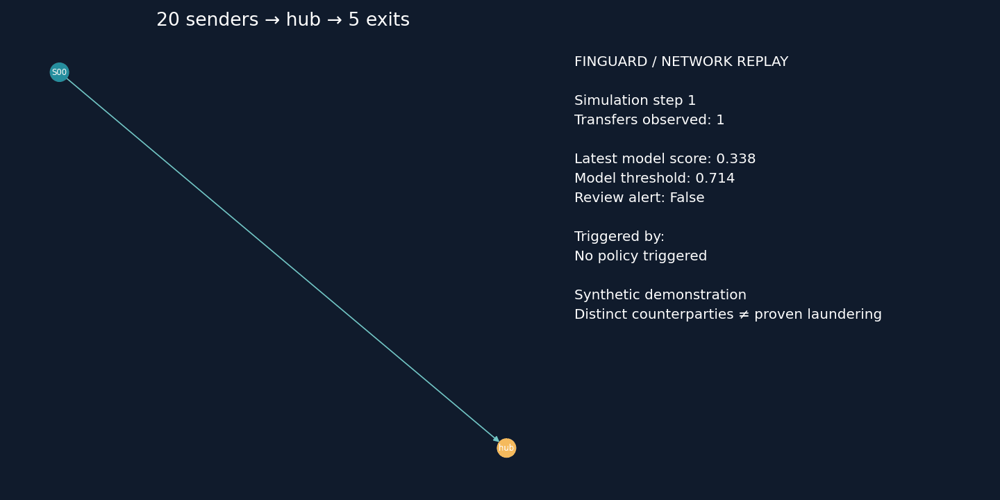

# FinGuard

**Explainable financial-network risk detection with temporal graph features.**

FinGuard is a Python research prototype combining SQL transaction monitoring, XGBoost,
Isolation Forest, rolling graph motifs, FastAPI and a Streamlit investigator dashboard.
It ships with executable experiments, measured results, tests, an animated demonstration,
and a technical report.

> **Research finding:** Graph features did not establish a reliable improvement over the
> transaction-and-activity XGBoost baseline on the selected IBM AMLSim sample.
> The paired average-precision difference was +0.00149, with a 95% block-bootstrap
> interval of −0.00090 to +0.00436. This is a useful negative result, not a claim of superiority.



## Research question

Do strictly historical graph features improve detection of **transfers involving
simulator-labelled accounts**, compared with amount and account-activity features,
at thresholds selected under a 5% validation false-positive-rate budget?

**Scope:** the published IBM sample labels accounts, not individual transactions.
The benchmark target is whether either endpoint is labelled `isFraud=1`.
It is not transaction-level money-laundering ground truth or a real-world fraud benchmark.
A second ingestion adapter supports transaction-level `isSAR` labels from current AMLSim
raw simulator logs; no results on that adapter's data are claimed in this release.

## Quick start

Python 3.12 is the tested runtime. From this folder:

```bash
python -m venv .venv
source .venv/bin/activate
# Windows PowerShell: .venv\Scripts\Activate.ps1
python -m pip install -r requirements-lock.txt
python -m pip install -e . --no-deps
python -m pytest -q
python scripts/demo.py
python -m streamlit run dashboard.py --server.address 127.0.0.1
```

The saved model and results are included. `scripts/demo.py` deliberately refuses to
overwrite an existing `finguard.db`. Move your previous demo database before rerunning.
The dashboard's Investigation view reads the local demo ledger; Research evaluation
shows the measured comparison and ablation. No external credentials are needed.

## Reproduce the research

```bash
python -m finguard.experiment
python scripts/write_report.py
python scripts/make_demo_media.py  # after scripts/demo.py
```

The experiment downloads a pinned IBM archive only when it is absent, checks SHA-256,
extracts three explicitly named files, constructs strict-past features, trains nine
comparators, selects validation thresholds, evaluates the temporal test set, and writes
metrics, 300-replicate time-block intervals, paired ablations and three-seed sensitivity.
The downloadable project bundle includes the archive for offline reproduction;
`data/raw/` is ignored in Git. Reproduction overwrites `reports/` experiment outputs and
`models/`. Use a fresh checkout for new external-data experiments.

`requirements-lock.txt` pins the tested direct dependencies; it is not a complete
transitive lock or a platform-independent environment image. See the dataset manifest
for the actual experiment package versions. CI runs deterministic tests, not the full
network-dependent research experiment.

## Results at validation-selected thresholds

| Method | Precision | Recall | PR-AUC (AP) | Test FPR |
|---|---:|---:|---:|---:|
| Robust amount deviation | 0.674 | 0.201 | 0.502 | 0.0523 |
| Rules | 0.962 | 0.006 | 0.488 | 0.0001 |
| Graph motif score | 0.797 | 0.314 | 0.646 | 0.0429 |
| Isolation Forest | 0.838 | 0.554 | 0.778 | 0.0575 |
| Logistic regression | 0.844 | 0.582 | 0.773 | 0.0580 |
| XGBoost transaction + activity | 0.862 | 0.595 | 0.814 | 0.0512 |
| XGBoost graph only | 0.805 | 0.407 | 0.693 | 0.0529 |
| XGBoost full | 0.850 | 0.601 | 0.815 | 0.0569 |
| XGBoost without cycle features | 0.847 | 0.601 | 0.815 | 0.0581 |

AP is non-interpolated average precision, not trapezoidal PR integration. The full
model's test FPR exceeds the validation budget: future FPR is not guaranteed.
Threshold selection happens on validation only. See [technical report](reports/TECHNICAL_REPORT.md)
for exact splits, uncertainty, leakage controls and substantive limitations.

## Operational API

Use two different random API keys (minimum 24 characters); keep them out of Git.

```bash
export FINGUARD_INGEST_KEY="$(python -c 'import secrets; print(secrets.token_urlsafe(32))')"
export FINGUARD_READ_KEY="$(python -c 'import secrets; print(secrets.token_urlsafe(32))')"
python -m uvicorn finguard.api:app --host 127.0.0.1 --port 8000
```

Local API docs: `http://127.0.0.1:8000/docs`. In another terminal with the keys available:

```bash
curl http://127.0.0.1:8000/transactions \
  -H "X-API-Key: $FINGUARD_INGEST_KEY" -H 'Content-Type: application/json' \
  -d '{"transactions":[{"tx_id":"new-001","step":26,"sender":"hub","receiver":"new-exit","amount":300}]}'
curl http://127.0.0.1:8000/alerts -H "X-API-Key: $FINGUARD_READ_KEY"
```

The demo above leaves the ledger at step 25, so this request advances to step 26.
For an empty database, any nonnegative starting step works. Each batch must contain
all transfers for a given step; subsequent batches must start after the stored maximum
step. Duplicate IDs and late arrivals are rejected with HTTP 409. Bad input receives 422;
missing configured keys fail closed with 503. All SQL insertions and the ingestion audit
record commit atomically, using parameterized SQL and a write transaction.

**Alert policy:** full-model threshold OR an explicit gather/scatter rule (at least 20
prior incoming counterparties and cumulative outgoing value including this transfer
at least half recent incoming value). The rule is a demonstration policy, not a regulatory
threshold. Hybrid policy metrics are not the standalone model metrics above.
Responses identify the triggering policy, model fingerprint, observed evidence and
additive TreeSHAP log-odds contributions. Scores are uncalibrated, not probabilities of crime.

## Data and leakage controls

- Source: [IBM AMLSim](https://github.com/IBM/AMLSim), commit
  `7338a4bcb1af9bcfea2201ad7daccfe2a4d569ca`, sample `20K_fanin200cycle200.tgz`.
- 20,000 accounts; 120,558 transfers; 200 fan-in and 200 cycle patterns per sample metadata.
- Required identifiers, finite amounts and integer steps are validated; missing values
  and duplicate transaction IDs are rejected, not silently imputed or dropped.
- Account labels, `fraudStep`, balances, alert IDs and raw account IDs never enter models.
- Graph window: previous 30 simulation steps; all same-step transfers see the same past.
- Chronological train/validation/test blocks with gaps; account histories may span splits.
  This estimates future activity on the same network, not unseen-account generalization.
- Training-only class weighting and scaling; no resampling before splitting; Isolation
  Forest fits the full unlabelled training mixture rather than presumed clean data.
- See [data card](data/DATA_CARD.md) and [manifest](reports/dataset_manifest.json).

To evaluate your own current AMLSim raw logs (headerless 11-column Java output):

```bash
python -m finguard.experiment --amlsim-raw /path/to/tx_log.csv
```

Generate those logs in the separate upstream environment described in
[AMLSim's README](https://github.com/IBM/AMLSim/blob/master/README.md).
Do not install AMLSim's legacy Java/Python dependencies into FinGuard's environment.
The adapter deliberately rejects converted or differently shaped CSVs; extend and test
an explicit mapping rather than guessing column semantics. Both classes must exist in
each split. This release verifies the adapter with a schema fixture, not an upstream simulator run.

## Project map

```text
finguard/       ingestion, historical features, experiment, SQL service, API
scripts/        demonstration, report generation, graph replay rendering
tests/          temporal leakage, graph motifs, validation, API roles, atomicity, dashboard
models/         native XGBoost JSON and metadata
reports/        technical report, measured metrics, intervals, ablations, plots and replay
data/           data card and upstream licence
.github/        GitHub Actions test workflow
```

## Security and responsible use

This is a local synthetic-data prototype, not a production AML control. Bind both UI
and API to loopback. The dashboard intentionally has no public authentication.
API keys are role-specific but provide no identity lifecycle or revocation database.
SQLite files and audit rows are not encrypted or tamper-proof. See [SECURITY.md](SECURITY.md).
No automatic account freezing, customer accusation, suspicious-activity filing or
real-money action is implemented. Investigators must assess alternative explanations.

## Repository

Source: https://github.com/Abass69/FinGuard

Clone this repository, then follow Quick start above. Local `.env`, database,
virtual environment and cache files are excluded from Git. The GitHub Actions
workflow checks the committed code; inspect the Actions tab for its current status.

## Licence and citation

Original FinGuard code is MIT licensed. IBM's bundled sample is distributed under its
repository's Apache-2.0 terms, preserved in `data/AMLSim-LICENSE`; no separately stated
sample-specific licence was found. See `NOTICE` for upstream attribution and references.
