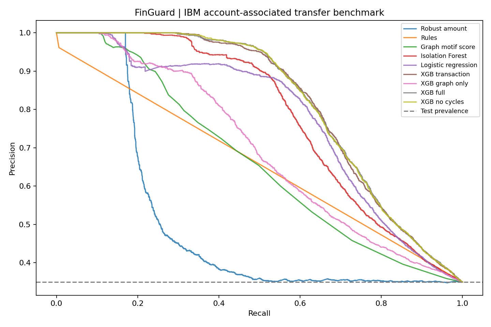
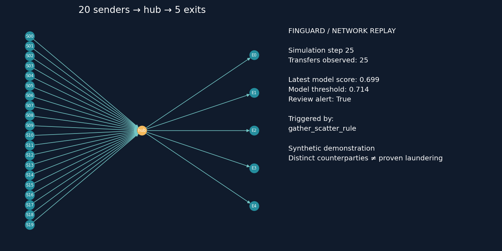

# FinGuard: Financial-network risk detection with temporal graph features

Technical report · Version 0.1.0 · 16 November 2026

## Abstract

FinGuard evaluates whether historical graph structure improves classification of
synthetic transfers associated with simulator-labelled accounts. Nine statistical,
rule, anomaly, linear and boosted-tree configurations were evaluated on a pinned IBM
AMLSim archive. The full XGBoost model reached average precision (AP) 0.8154,
precision 0.8501, recall 0.6009 and false-positive rate 0.0569 on the temporal holdout.
Its AP gain over amount-and-activity features was 0.00149; a paired time-block 95%
interval [−0.00090, +0.00436] includes zero. The study therefore does not establish
that graph features improve detection on this sample. An operational prototype
provides authenticated ingestion, SQL persistence, model/rule alerts, TreeSHAP
explanations and a local investigator dashboard.

## 1. Research question and hypotheses

**Question:** Do rolling, strictly historical graph features improve detection of
transfers involving simulator-labelled accounts compared with amount and local
activity features, at thresholds selected under a validation FPR budget of 5%?
The primary comparison is XGBoost full versus XGBoost transaction + activity using
identical hyperparameters and splits. The hypothesis is a positive paired AP gain;
secondary ablations isolate graph-only predictors and removal of cycle features.
This is graph feature engineering, not a graph neural network study.

## 2. Source, licence and target validity

Source: [IBM AMLSim](https://github.com/IBM/AMLSim), pinned commit
`7338a4bcb1af9bcfea2201ad7daccfe2a4d569ca`. The published archive
`20K_fanin200cycle200.tgz` contains 120,558 transfers, 20,000 accounts and 1,803
fraud-labelled accounts. Its metadata describes 200 fan-in and 200 cycle patterns.
The upstream repository is Apache-2.0; its licence is preserved with the project.
No separate sample-specific licence was identified. The source archive and per-file
checksums are recorded in the pipeline and dataset manifest.

Crucially, this archive contains **account-level** `isFraud` labels. The experiment
sets transfer label to 1 if either endpoint is such an account. This identifies
association with a flagged account, not the illicit nature of a transfer. It can
include activity before the simulator's `fraudStep`. Neither that field nor labels,
alert IDs, balances or raw identifiers enter predictors. This target limitation
prevents any claim of transaction-level laundering detection accuracy.

The project also implements and fixture-tests an adapter for the current AMLSim
Java raw log containing transaction-level `isSAR`. No upstream simulator execution
or performance result on newly generated raw logs is claimed. This release
reproduces analysis of the published sample, not its original generation process.

## 3. Preprocessing, missingness and imbalance

Required IDs, finite nonnegative amounts and nonnegative integer simulation steps
are validated. Missing required values, unknown node references and duplicate IDs
are rejected. No required values were missing in the evaluated sample. Self-transfers,
zero amounts and repeated transfers with distinct IDs are retained. Stable transfer
IDs are derived from source row positions. No physical duration or currency is inferred.

There is no random undersampling, oversampling or SMOTE. The overall positive rate
is 29.73%; this is a moderately imbalanced association task rather than a realistic
rare-laundering prevalence. Logistic regression uses training class weights; XGBoost
uses the training negative/positive ratio. Isolation Forest is fit to the complete
unlabelled training mixture, which may dilute anomaly separation at this prevalence.
StandardScaler is fitted to training only for logistic regression.

## 4. Features and temporal protocol

All historical features use a 30-step sliding window ending strictly before the
current step. Every transfer at a tied step sees the same history. The current
transfer's amount and endpoints are available at decision time; it is inserted into
history only after all features at its step are emitted.

| Feature group | Predictors |
|---|---|
| Transaction | log(1 + amount) |
| Local activity | sender outgoing count, receiver incoming count, current amount relative to each corresponding historical mean |
| Graph | sender/receiver incoming and outgoing distinct counterparties, prior reverse edge, directed three-node cycle closure, sender outgoing-to-incoming value ratio including current transfer |

The flow ratio is clipped at 100; it is zero when the sender has no prior incoming
transfers. Count/degree features distinguish transfer frequency from counterparties.
Graph state contains no labels. No full-sample centrality, future edges or target
aggregations are used. Tests verify future invariance, same-step isolation and
label invariance.

| Split | Simulation steps | Transfers | Positive rate |
|---|---|---:|---:|
| train | 1–80 | 67,450 | 27.98% |
| validation | 90–110 | 23,113 | 30.80% |
| test | 120–149 | 11,853 | 34.96% |

The 18,142 gap rows contribute unlabelled past context but not fitted examples or
scored metrics. This is an online-observable history design, not a purge of all
cross-boundary network influence. Accounts and potentially simulated patterns can
span splits. No target encoding is performed, but results are conditional on this
same network and do not estimate generalization to unseen accounts or institutions.
The gaps are shorter than the feature window; they are not claimed as a full embargo.

## 5. Models and selection

- **Robust amount:** absolute log-amount deviation from training median, divided by
  training median absolute deviation.
- **Rules:** additive score for high fan-in, gather/redistribution and directed-cycle
  conditions. Rule thresholds are fixed in code; score cutoff uses validation.
- **Graph motif score:** max incoming distinct-counterparty degree plus five times
  reverse-edge and triangle-closure indicators.
- **Isolation Forest:** 150 trees, seed 42, transaction and activity features.
- **Logistic regression:** standardized transaction/activity predictors, balanced
  training weights, 1,000 maximum solver iterations.
- **XGBoost:** 160 trees, depth 3, learning rate 0.06, subsample 0.85, L2 penalty 5,
  minimum child weight 10, histogram trees, seed 42 and two CPU workers.

The XGBoost settings are fixed across ablations. There is no hyperparameter search
or test-driven model selection. Validation chooses the threshold maximizing recall
subject to empirical FPR ≤ 5%, with the highest cutoff resolving recall ties.
Each model's threshold remains fixed for test evaluation and bootstrap resampling.
No held-out labels inform feature construction or fitted model parameters.

## 6. Measured results

| Model | Precision | Recall | AP | FPR | TP | FP | FN | TN |
|---|---:|---:|---:|---:|---:|---:|---:|---:|
| Robust amount | 0.6739 | 0.2010 | 0.5021 | 0.0523 | 833 | 403 | 3311 | 7306 |
| Rules | 0.9615 | 0.0060 | 0.4879 | 0.0001 | 25 | 1 | 4119 | 7708 |
| Graph motif score | 0.7972 | 0.3139 | 0.6463 | 0.0429 | 1301 | 331 | 2843 | 7378 |
| Isolation Forest | 0.8381 | 0.5536 | 0.7779 | 0.0575 | 2294 | 443 | 1850 | 7266 |
| Logistic regression | 0.8437 | 0.5823 | 0.7729 | 0.0580 | 2413 | 447 | 1731 | 7262 |
| XGB transaction | 0.8619 | 0.5948 | 0.8139 | 0.0512 | 2465 | 395 | 1679 | 7314 |
| XGB graph only | 0.8053 | 0.4073 | 0.6935 | 0.0529 | 1688 | 408 | 2456 | 7301 |
| XGB full | 0.8501 | 0.6009 | 0.8154 | 0.0569 | 2490 | 439 | 1654 | 7270 |
| XGB no cycles | 0.8475 | 0.6006 | 0.8150 | 0.0581 | 2489 | 448 | 1655 | 7261 |

Test positive prevalence is 34.96%, which is the random-ranking AP reference.
PR-AUC is reported using **non-interpolated average precision**, not trapezoidal
integration. Precision is TP/(TP+FP), recall TP/(TP+FN), and FPR FP/(FP+TN).
At the full-model threshold 0.714266, there are 2,929 alerts, including 439 false
positives; 1,654 positive proxy-labelled transfers are missed. The test FPR of 5.69%
exceeds the validation budget. Validation constraints are not guarantees under shift.

Approximate full-model 95% intervals:

| Metric | Lower | Upper |
|---|---:|---:|
| precision | 0.8368 | 0.8731 |
| recall | 0.5735 | 0.6412 |
| pr_auc_ap | 0.7953 | 0.8438 |
| fpr | 0.0520 | 0.0617 |

Intervals use 300 bootstrap draws of six non-overlapping five-step test blocks with
replacement, preserving within-block temporal dependence. They condition on the
fitted model and chosen split. Six blocks provide limited inferential resolution;
longer-range account dependencies, overlapping network histories and model-fitting
uncertainty are not captured. These intervals are exploratory, not strong population
or regulatory evidence. Complete intervals for every model are in the JSON output.

## 7. Ablation and seed sensitivity

| Paired comparison | AP difference | 95% block interval |
|---|---:|---|
| Full minus XGB transaction | +0.00149 | [-0.00090, +0.00436] |
| Full minus XGB no cycles | +0.00033 | [-0.00076, +0.00108] |
| Full minus XGB graph only | +0.12188 | [+0.11117, +0.13300] |

Adding all graph predictors to transaction/activity predictors gives a small AP gain
whose interval crosses zero. Removing reverse-edge and cycle-closure indicators
barely changes AP. Graph-only XGBoost is substantially weaker than the full model.
The full model also has lower precision and higher FPR than the transaction/activity
baseline at their separate validation-selected cutoffs. Graph features do **not**
dominate every operational trade-off.

Repeating the central ablation with seeds 7, 19 and 42 gives transaction/activity AP
0.8137–0.8142 and full-model AP 0.8154–0.8172. These are initialization sensitivity
checks on the same simulation and split, not independent dataset replications.
See `seed_sensitivity.csv`. A larger independently generated study is needed before
choosing a more complex graph model on predictive grounds.

## 8. Operational prototype and explanation

FastAPI accepts ordered batches of simulated transactions. SQLite stores transfers,
scores, feature snapshots, model fingerprints and ingestion audit records in one
atomic transaction. Separate ingestion and investigator API keys are checked using
constant-time comparison. Queries are parameterized. Pydantic rejects extra fields,
including attempts to submit labels as model inputs. Duplicate and late events are
rejected; all same-step events must arrive in one batch. Model files use native
XGBoost JSON rather than pickle. The dashboard reads SQLite in read-only mode.

The local bounded prototype recomputes history on ingestion to share exactly the
experiment feature code. It is capped at 10,000 stored transfers and 1,000 per batch;
this favors auditability over throughput. It is not a streaming-scale architecture.
There is no throughput SLA, persistent feature store or late-event correction engine.

Each alert includes observed motif evidence and exact tree contributions to the
XGBoost log-odds margin. The API returns all contributions plus the base value;
the dashboard shows the three strongest by absolute magnitude. A test verifies
that applying the logistic function to their sum reconstructs the returned score.
These explain model behavior, not causal guilt or criminal intent.

The operational alert policy is model threshold OR a gather/scatter rule: at least
20 earlier incoming counterparties plus outgoing/incoming value ≥ 0.5. This separate
rule is deliberately labelled; its hybrid performance is **not** the benchmark's
standalone XGBoost performance. The controlled demonstration has 20 senders, 10,000
units collected and 9,500 redistributed to five exits. The model produces five
alerts; the hybrid policy produces eight. At the final outgoing transfer, the model
score is 0.6995 (below its cutoff), while the explicit rule raises the review alert.
This demonstrates the distinction between a model limitation and a useful policy.

## 9. Validation and reproducibility

The local automated suite passes 20 tests covering missing/invalid values, duplicate
IDs, raw-log mapping, temporal and label invariance, window expiration, cycle closure,
scenario detection, authentication roles, fail-closed configuration, rejected label
injection, atomic duplicate handling, incremental/batch parity, TreeSHAP consistency,
and dashboard rendering through Streamlit AppTest. Dependency deprecation warnings
are recorded; no failed assertions remain. This does not substitute for a security
penetration test or full browser accessibility review.

`python -m finguard.experiment` reproduces the experiment from the pinned archive;
`python scripts/write_report.py` renders this report from stored measured outputs.
The direct dependency pins and version manifest capture the tested environment.
Transitive packages and hardware differences can affect exact numerical results.
A GitHub Actions workflow is supplied; a successful hosted CI run is not claimed
until the repository is published and the workflow actually executes.

## 10. Limitations, ethics and future research

The largest limitation is label validity: retrospective account association is not
transaction-level fraud. One hand-designed, relatively small simulator archive can
encode patterns unlike real institutions. No realistic low-prevalence stress test,
unseen-account test, independent AMLSim seeds or institution holdout is included.
IDs are not predictors, but persistent account behavior still carries across time.
The model is not calibrated; a score of 0.85 is not an 85% probability of laundering.
Bootstrap uncertainty underestimates dependencies beyond five steps. Normal payments
processors, charities and collection accounts can resemble gather/scatter networks.

FinGuard makes no automatic financial or enforcement decisions. Human review should
consider legitimate explanations, data provenance and asymmetric harms. No protected
attributes or real customer data are used, so demographic fairness is unmeasured,
not proven. Before real-data work, obtain lawful access, minimize retained data and
apply appropriate institutional review and governance. This project provides no
regulatory compliance certification.

Priority extensions: generate multiple independently seeded AMLSim raw logs with
transaction-level labels; hold out complete networks and typologies; evaluate delayed
labels and temporal drift; stress-test realistic prevalence and investigator capacity;
compare temporal GNNs against these baselines; assess calibration; test adversarial
pattern changes; and implement authenticated, tenant-isolated, encrypted deployment
with externally immutable audit records. The current dashboard has no public auth;
keep it on loopback. API keys, SQLite and local audit are prototype controls only.

## References

1. IBM AMLSim repository and README: https://github.com/IBM/AMLSim
2. Pinned sample: https://github.com/IBM/AMLSim/tree/7338a4bcb1af9bcfea2201ad7daccfe2a4d569ca/sample
3. Raw-log writer schema: https://github.com/IBM/AMLSim/blob/7338a4bcb1af9bcfea2201ad7daccfe2a4d569ca/src/main/java/amlsim/TransactionRepository.java
4. Upstream requested citation: Suzumura and Kanezashi, Anti-Money Laundering Datasets, 2021.

Supporting evidence: `metrics.csv`, `confidence_intervals.json`, `ablation.json`,
`seed_sensitivity.csv`, `dataset_manifest.json`, `test_predictions.csv`, `tests.log`
and `demo_results.json` in this directory.
